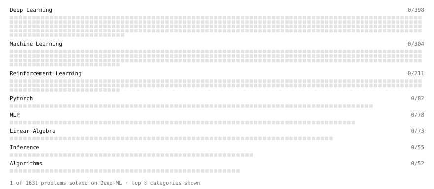

# Deep-ML

My machine learning practice from [Deep-ML](https://www.deep-ml.com). Every solution here was written by hand.

**3** solved · 3 problems · 0 labs · 0 math

[**Browse the interactive portfolio**](https://aapaul29.github.io/deep-ml/) to replay this filling in over time.

## Problems

| | Difficulty | Solved | |
| --- | --- | --- | --- |
| [Forward Kinematics of a 2-Link Planar Arm](https://www.deep-ml.com/problems/1210) | easy | 2026-10-24 | [solution](problems/1210-forward-kinematics-of-a-2-link-planar-arm) |
| [Matrix-Vector Dot Product](https://www.deep-ml.com/problems/1) | easy | 2026-10-24 | [solution](problems/0001-matrix-vector-dot-product) |
| [Reshape Matrix](https://www.deep-ml.com/problems/3) | easy | 2026-10-24 | [solution](problems/0003-reshape-matrix) |

---

_This file is regenerated by Deep-ML on every push._
